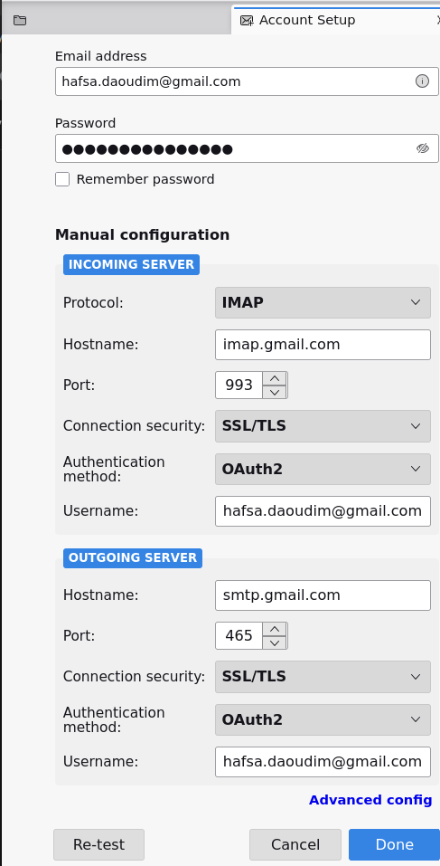
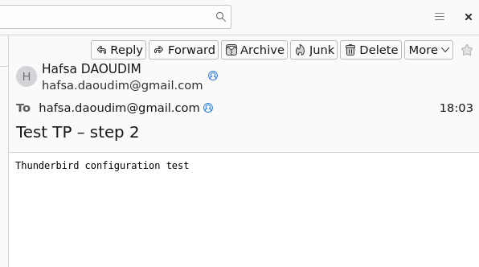

# 02 – Configuring Thunderbird with Gmail

## Account settings
| Server | Protocol | Host | Port | Security | Authentication |
|---|---|---|---|---|---|
| Incoming | IMAP | imap.gmail.com | 993 | SSL/TLS | OAuth2 |
| Outgoing | SMTP | smtp.gmail.com | 465 | SSL/TLS | OAuth2 |

## Technical choices
- **IMAP rather than POP3**: emails stay on the Gmail server, so test messages stay in sync.
- **SSL/TLS**: the connection between Thunderbird and Gmail is encrypted.
- **OAuth2**: Google issues a token to Thunderbird. The account password is never stored locally, and access can be revoked from the Google account.

## Send test
Email sent to my own address and received successfully:

## Key takeaway: TLS ≠ end-to-end encryption
| | TLS | PGP / S/MIME |
|---|---|---|
| Protects | the transport (computer ↔ server) | the message itself |
| Email stored at Gmail | **readable** by Google | **encrypted**, unreadable by Google |
| Authenticates the sender | no | yes (signature) |

TLS is necessary but not sufficient. The following steps add **end-to-end** security with PGP and then S/MIME.
