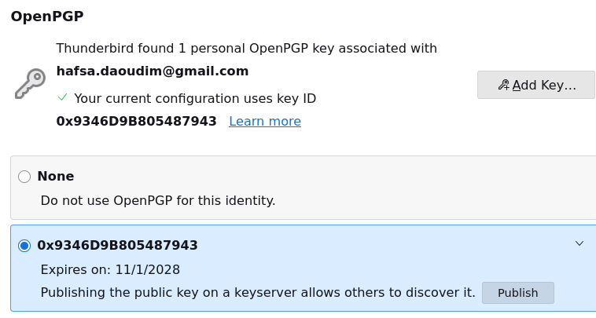
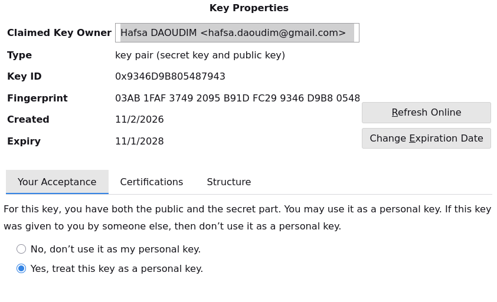

# 03 – Creating and Analysing a PGP Key Pair

## Key generation (Thunderbird)
| Parameter | Value |
|---|---|
| Owner (user ID) | Hafsa DAOUDIM <hafsa.daoudim@gmail.com> |
| Algorithm | RSA |
| Key size | 3072 bits (≈ 128-bit security level) |
| Created | 2026-11-02 |
| Expires | 2028-11-01 (2 years, can be extended) |
| Key ID | `9346D9B805487943` |
| Fingerprint | `03AB 1FAF 3749 2095 B91D  FC29 9346 D9B8 0548 7943` |





> **Key ID = last 64 bits of the fingerprint**: `...9346 D9B8 0548 7943`.
> The fingerprint is a SHA-1 hash of the public key packet (v4 keys). It is what two people compare over a trusted channel to verify a key (see step 05).

## Exporting the public key
The public key was exported from Thunderbird's keyring to [`pgp/my-public-key.asc`](../pgp/my-public-key.asc).
Check that it contains no secret material: `grep -c "PRIVATE KEY"` → `0`.

## Overview
```bash
gpg --show-keys --with-fingerprint pgp/my-public-key.asc
```
```
pub   rsa3072 2026-11-02 [SC] [expires: 2028-11-01]
      03AB 1FAF 3749 2095 B91D  FC29 9346 D9B8 0548 7943
uid                      Hafsa DAOUDIM <hafsa.daoudim@gmail.com>
sub   rsa3072 2026-11-02 [E] [expires: 2028-11-01]
```
- **pub [SC]**: primary key, used to **S**ign and **C**ertify (sign other keys).
- **sub [E]**: subkey, used to **E**ncrypt.

## Packet-level analysis
```bash
gpg --list-packets --verbose pgp/my-public-key.asc
```
Full output: [`outputs/03-list-packets.txt`](../outputs/03-list-packets.txt)

The key is made of **5 packets**:

| # | Packet (tag) | Content |
|---|---|---|
| 1 | Public key packet (6) | Primary key: RSA, key ID `9346D9B805487943` |
| 2 | User ID packet (13) | `Hafsa DAOUDIM <hafsa.daoudim@gmail.com>` |
| 3 | Signature packet (2), class `0x13` | Self-signature binding the user ID to the primary key |
| 4 | Public sub key packet (14) | Encryption subkey: RSA, key ID `C1B4AA36AA2C447E` |
| 5 | Signature packet (2), class `0x18` | Subkey binding signature (the primary key signs the subkey) |

### 1. Public key packet: primary key
```
version 4, algo 1, created 1793643559, expires 0
pkey[0]: DC95A98A63C8E02A...5F53   (384 bytes)
pkey[1]: 010001
keyid: 9346D9B805487943
```
- `algo 1` = **RSA**.
- `created 1793643559` = Unix timestamp → 2026-11-02 18:19:19 UTC.
- `pkey[0]` = RSA **modulus n** (n = p × q): 384 bytes = **3072 bits**.
- `pkey[1]` = public **exponent e** = `0x010001` = **65537**.
- `expires 0`: in OpenPGP v4 the expiry date is not stored in the key packet but in the self-signature (see subpacket 9 below).

### 2. User ID packet
Contains the identity claimed by the owner. ⚠️ Nothing checks that the creator really owns this address, which is why keys must be **verified and certified** (step 05).

### 3. Signature packet: user ID self-signature (`sigclass 0x13`)
| Field | Value | Meaning |
|---|---|---|
| `algo 1` | RSA | Signed with the primary private key |
| `sigclass 0x13` | Positive certification | "I own this key and this user ID" |
| `digest algo 8` | SHA256 | Hash function used for the signature |
| `begin of digest af 10` | | First 2 bytes of the hash (quick integrity check) |
| subpkt 9 | key expires after 2y | Key expiry date |
| subpkt 27 | key flags `03` | `0x01` Certify + `0x02` Sign → **[SC]** |
| subpkt 11 | pref-sym-algos `9 8 7` | AES256 > AES192 > AES128 |
| subpkt 21 | pref-hash-algos `8 9 10 11` | SHA256 > SHA384 > SHA512 > SHA224 |
| subpkt 22 | pref-zip-algos `2 3 1 0` | ZLIB > BZIP2 > ZIP > none |
| subpkt 33 / 16 | issuer fpr / issuer key ID | Who made the signature (myself) |
| `data` | 384 bytes | The RSA signature value itself |

The preferences tell **other people's software** which algorithms to use when they encrypt to me. Only strong algorithms are listed (no 3DES, CAST5, SHA1; see step 01).

### 4. Public sub key packet: encryption subkey
```
version 4, algo 1, created 1793643560
pkey[0]: C6B0657F...D7EC50B   (3072-bit modulus)
pkey[1]: 010001               (e = 65537)
keyid: C1B4AA36AA2C447E
```
An independent RSA key pair, with its own modulus and its own key ID.

### 5. Signature packet: subkey binding (`sigclass 0x18`)
- Made by the **primary key** (`keyid 9346D9B805487943`), proving the subkey belongs to me.
- `key flags 0C` = `0x04` encrypt communications + `0x08` encrypt storage → **[E]**.

## Why a separate encryption subkey?
- **Separation of roles**: signing identity (long-term) vs encryption (can be rotated).
- If the encryption subkey is compromised or expires, a new one can be issued **without losing the identity**, its fingerprint and the certifications collected from others.

## Revocation certificate 🔒
Thunderbird automatically generated a revocation certificate when the key was created
(`<profile>/0x9346D9B805487943_rev.asc`). It was copied to a private backup folder **outside this repository**.
The armour header is prefixed with `:` so it cannot be imported by accident.
It will be used in step 06.
