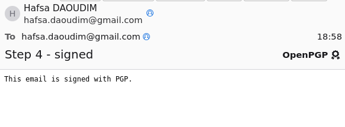
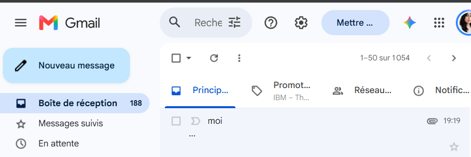
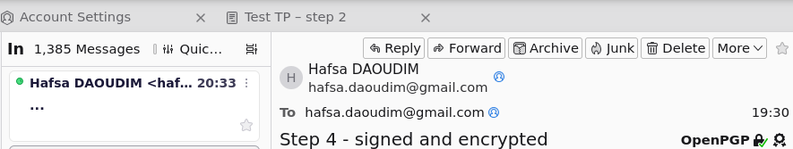

# 04 – Signed and Encrypted Emails with PGP

Three emails were sent to myself from Thunderbird with my PGP key `9346D9B805487943`,
then saved as `.eml` files and analysed.

| Email | File | Thunderbird result |
|---|---|---|
| Signed only | [`pgp/signed-email.eml`](../pgp/signed-email.eml) | Good digital signature |
| Encrypted only (subject encrypted) | [`pgp/encrypted-email.eml`](../pgp/encrypted-email.eml) | Message is encrypted |
| Signed and encrypted | [`pgp/signed-encrypted-email.eml`](../pgp/signed-encrypted-email.eml) | Encrypted + good signature |

> 🔒 Privacy: Gmail adds the sender's public IP address in the `Received:` header.
> These addresses were replaced by `REDACTED` before publishing. This does not affect the
> PGP signature, which covers the message body and not the transport headers.

---

## 1. Signed email



### MIME structure
```bash
grep -iE "^Content-Type|protocol=|protected-headers|BEGIN PGP|END PGP" pgp/signed-email.eml
```
```
multipart/signed; micalg=pgp-sha256; protocol="application/pgp-signature"
├── multipart/mixed; protected-headers="v1"
│   ├── text/plain                         ← the message (readable by anyone)
│   └── application/pgp-keys               ← my public key, attached automatically
└── application/pgp-signature              ← OpenPGP_signature.asc
    -----BEGIN PGP SIGNATURE----- … -----END PGP SIGNATURE-----
```
| Element | Meaning |
|---|---|
| `multipart/signed` | The email is split into **content + detached signature** (PGP/MIME, RFC 3156) |
| `micalg=pgp-sha256` | Hash algorithm used before signing: **SHA-256** |
| `protected-headers="v1"` | From, To, Subject and Message-ID are copied **inside** the signed part, so they are signed too |
| `application/pgp-keys` | Thunderbird attaches my public key so the recipient can verify the signature |

⚠️ A signed email is **not confidential**: the body is in clear text. The signature only provides
**integrity, authentication and non-repudiation**.

### Signature packet
```bash
sed -n '/BEGIN PGP SIGNATURE/,/END PGP SIGNATURE/p' pgp/signed-email.eml | gpg --list-packets --verbose
```
Full output: [`outputs/04-signature-packets.txt`](../outputs/04-signature-packets.txt)

| Field | Value | Meaning |
|---|---|---|
| `algo 1` | RSA | Signature made with the private key |
| `keyid` | `9346D9B805487943` | My **primary** key (the [SC] key), not the encryption subkey |
| `digest algo 8` | SHA-256 | The message is hashed, then the hash is signed |
| `data` | 3072-bit value | The hash encrypted with my RSA private key |

**How verification works:** the recipient hashes the received message with SHA-256, decrypts
the signature with my **public** key, and compares both hashes. Any modification of the message
changes the hash, so the signature fails.

> Note: running `gpg --list-packets` on the whole `.eml` shows my **public key** instead of the signature,
> because gpg reads the first PGP block in the file, which is the attached key.
> That is why the signature block is extracted first with `sed`.

---

## 2. Encrypted email

| In Thunderbird before opening | In Gmail web: Google cannot read it |
|---|---|
|  |  |

### MIME structure
```
Subject: ...                                      ← real subject is encrypted
Content-Type: multipart/encrypted; protocol="application/pgp-encrypted"
├── application/pgp-encrypted                     ← version identifier
└── application/octet-stream; name="encrypted.asc"
    -----BEGIN PGP MESSAGE----- … -----END PGP MESSAGE-----
```
- `Subject: ...`: with **Encrypt Subject** enabled, the real subject is moved inside the encrypted part.
- Gmail stores only the encrypted block: the email is protected **end to end**, not just in transit (unlike TLS, see step 02).

### Packets
```bash
gpg --list-packets --verbose pgp/encrypted-email.eml
```
Full output: [`outputs/04-encrypted-packets.txt`](../outputs/04-encrypted-packets.txt)

| # | Packet (tag) | Content |
|---|---|---|
| 1 | Pubkey enc packet (1) | Session key encrypted with RSA (`algo 1`) for key `C1B4AA36AA2C447E` |
| 2 | Pubkey enc packet (1) | Same session key, encrypted again for key `C1B4AA36AA2C447E` |
| 3 | Encrypted data packet (18) | The message encrypted with the session key, `mdc_method: 2` |

- **Key used: `C1B4AA36AA2C447E`**, the **encryption subkey [E]**, not the primary key. This matches the key structure analysed in step 03.
- **Two pubkey enc packets**: one for the **recipient** and one for the **sender** (so the email stays readable in the *Sent* folder). Here both are me, so the key ID is the same twice. With one other recipient, there would be two different key IDs.
- Each packet holds a **384-byte** value: the session key encrypted with a 3072-bit RSA public key.
- **Tag 18** = Symmetrically Encrypted **Integrity Protected** Data. `mdc_method: 2` means a Modification Detection Code (SHA-1) is appended, so any tampering with the ciphertext is detected.
- `decryption failed: No secret key` is **expected**: my private key is stored in Thunderbird, not in the gpg keyring. The structure is still visible.
- The **symmetric algorithm** is not visible: it is stored *inside* the encrypted session key. Following my key preferences (`pref-sym-algos: 9 8 7`, step 03), it is AES-256.

### PGP hybrid encryption, observed in practice
```
message ──AES (random session key)──▶ encrypted data packet (tag 18)
session key ──RSA (recipient public key C1B4…447E)──▶ pubkey enc packet (tag 1)
```

---

## 3. Signed and encrypted email



Full output: [`outputs/04-signed-encrypted-packets.txt`](../outputs/04-signed-encrypted-packets.txt)

| | Encrypted only | Signed and encrypted |
|---|---|---|
| Pubkey enc packets | 2 × `C1B4AA36AA2C447E` | 2 × `C1B4AA36AA2C447E` |
| Encrypted data packet | **537** bytes | **3935** bytes |

The structure seen from outside is **identical**. The signature is no longer visible, because the order is:

1. **sign** the message with my private key;
2. **encrypt** everything (message + signature + attached public key) with the session key.

That explains the larger encrypted packet. It also means an observer cannot even tell **who signed** the email: only the recipient discovers the signature after decryption.

---

## Summary

| Service | Signed | Encrypted | Signed + encrypted |
|---|---|---|---|
| Confidentiality | ❌ | ✅ | ✅ |
| Integrity | ✅ | ✅ (MDC) | ✅ |
| Authentication of sender | ✅ | ❌ | ✅ |
| Non-repudiation | ✅ | ❌ | ✅ |
